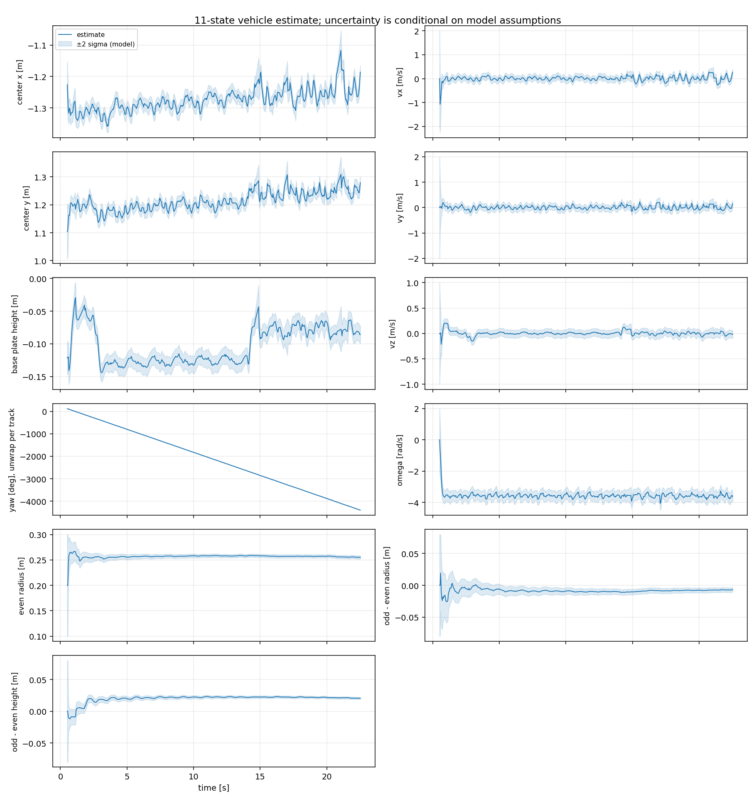
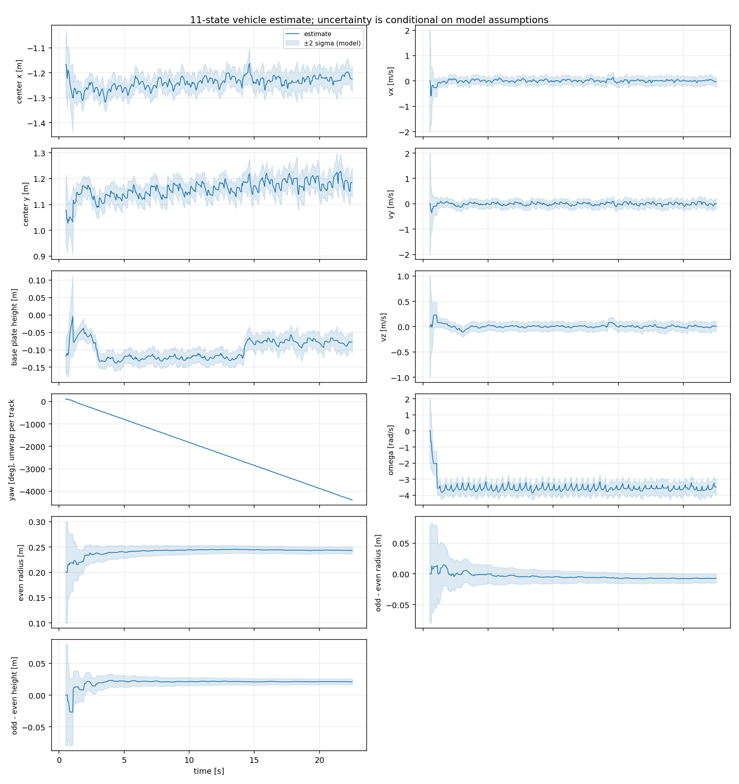
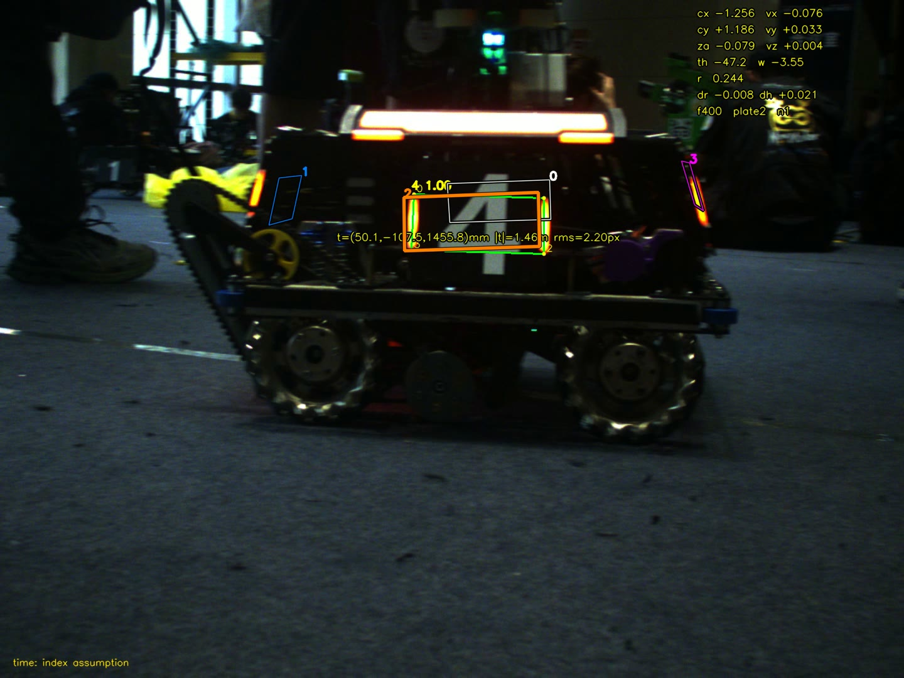
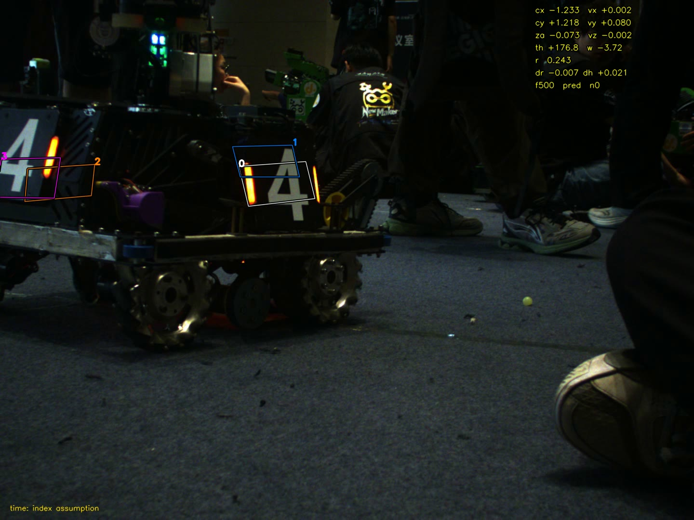
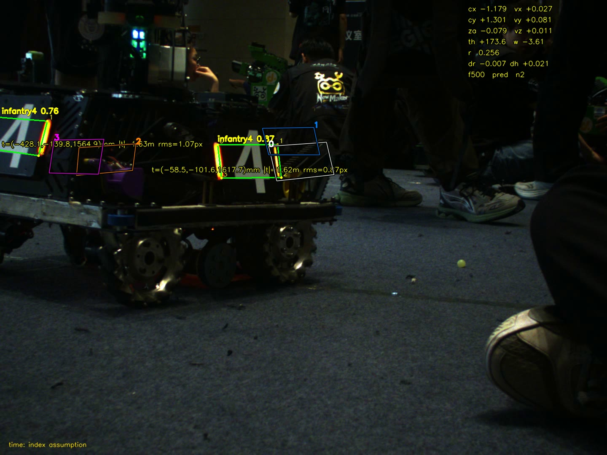
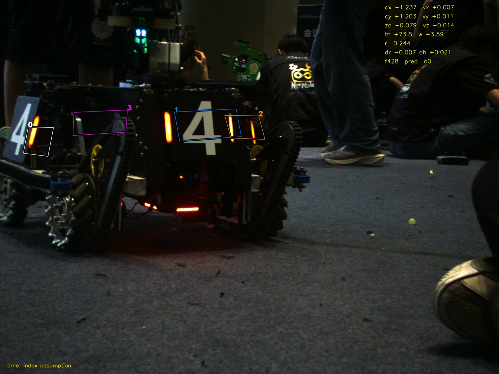

# 视觉第三周作业：整车状态估计

姓名：**王进康**（学号 926127940132），南京理工大学 RoboMaster Combat 战队视觉组。

本报告按作业要求的三项内容组织：**一、视频内容与曲线图**；**二、项目结构、代码设计、依赖配置与构建运行方法**；**三、代码仓库链接、PR 链接与最终提交的 commit hash**。

## 一、视频内容与曲线图

### 1.1 成品视频

| 项 | 内容 |
| --- | --- |
| 主交付 | `results/revision/submission_nn.avi`，神经网络检测，84 MB |
| 对照 | `results/revision/submission_trad.avi`，传统灯条检测，81 MB |
| 规格 | 1440×1080，531 帧，24.086 fps，22.0 s |

视频体积大不入库（`results/**/*.avi` 已忽略），可由仓库代码一条命令重新生成：

```bash
./build/rm_week3 data/test.avi --imu data/imu.txt --camera camera.yaml \
  --method nn --time-mode imu-index \
  --detection-cache results/revision/nn_detections.cache \
  --out results/revision/submission_nn.avi --csv results/revision/submission_nn.csv
```

传统检测器把 `--method nn` 换成 `--method trad`，其余参数不变。

**画面里画的是什么。** 画面叠加的是整车状态，不是检测框：

- 四块板固定配色，与第二周的检测层不撞色：白 0 号槽、蓝 1 号槽、橙 2 号槽、品红 3 号槽。每块先描黑边再画彩线，亮背景和暗背景都能读；当前帧融合到的那块加粗。
- 线框是该帧由 11 维状态外推、再经外参与畸变模型投影到相机系的四块板。背面两块是模型推断，**不是四块都被检出**；离相机不足 0.05 m 的板不画。
- 右上角七行状态，黄字黑描边：`cx/vx`、`cy/vy`、`za/vz`、`th/w`、`r`、`dr dh`，末行是本帧标注。
- 末行两种形态：`f<帧号> plate<j> n<量测数>` 表示本帧融合到 j 号槽；`f<帧号> pred n<量测数>` 表示本帧没有融合、四块板全是外推。`n` 是参与联合更新的板数。标 `pred` 是必要的，否则外推框会被误读成「检测框标错位置」。
- 第二周的绿色检测四边形与黄色角点默认不叠画，加 `--debug-detections` 才出现（本文 1.3 的截图为了看清量测来源打开了它）。

### 1.2 状态曲线

`python3 tools/plot_states.py <csv>` 生成 11 个子图（6×2 布局，末格留空），横轴为时间 0–22 s。





蓝线为估计，浅蓝带为模型 ±2σ。末 5 秒中位数：`r` 由 0.20 m 的初值收敛到 0.257 m（神经网络）与 0.243 m（传统）；`dr`、`dh` 分别收敛到 −7.8 / +21.5 mm 与 −7.3 / +21.2 mm；`omega` 由 0 起跳到 −3.58 rad/s 后稳定；`theta` 单调下降约 4300°，与 ω≈−3.6 rad/s 持续 22 s 的量级一致。

该 ±2σ 是条件于过程噪声与几何先验的不确定度，不是实测误差，也不代表场地位姿精度。
曲线不做分段强接：重捕会在图上断开，避免把不同参考板的角度连成一条。
两套检测方案相互独立，`dr`、`dh` 却收敛到同一量级，说明这两个机械量是被数据识别出来的，不是被噪声拟合出来的。

原始估计：[submission_nn.csv](results/revision/submission_nn.csv)；运行条件：[元数据](results/revision/submission_nn.csv.meta.json)。

### 1.3 关键帧

常规跟踪帧（第 400 帧），绿色是第二周的检测四边形，黄色是单板解算信息；橙色框对 4 号板标注的单帧重投影误差为 2.20 px。



同一帧（第 500 帧）两种检测器对比。NN 检出两块板并给出重投影误差，传统检测器该帧无输出；此时两者都被联合门限拒绝，四色框仍是预测，面板标 `pred`：





连续 7 帧无融合时（第 428 帧）四板预测已明显偏离真实板位；第 429 帧恢复更新后重新贴合，且 `r` 未跳回初值、`reinit=0`，说明轨迹是被保持而非重建：



## 二、项目结构、代码设计、依赖配置与构建运行方法

### 2.1 项目结构

版本库跟踪 77 个文件；`build/`、`data/`、`results/**/*.avi`、`*.cache` 不入库。

```text
rm_week3/
├── CMakeLists.txt              三个库/程序目标 + 评价器 + 4 个测试，见下表
├── camera.yaml                 内参、畸变、外参、噪声先验、半径范围
├── README.md                   依赖、数据准备、运行与验证命令
├── include/    20 个头文件
├── src/        15 个实现
├── tests/       4 个 CTest 用例
├── tools/       5 个脚本与评价器
├── models/     Infantry-v8n.onnx、mlp.onnx、label.txt（随仓库提交）
├── docs/       OPEN_SOURCE_REFERENCES.md 与两份第三方许可
├── results/    CSV、曲线、对比 JSON、验证记录、四张关键帧
└── 视觉第三周作业_王进康.md
```

按依赖切成三层，滤波与匹配不碰 OpenCV：

| 目标 | 依赖 | 内容 |
| --- | --- | --- |
| `rm_state` | 仅 C++17 标准库 | `ekf9`（`VehicleEkf`，11 维）、`tracker`、`imu_series`、`world_frame`、`frame_timeline` |
| `rm_pose` | `rm_state` + OpenCV | `camera`、`pnp_solver`、`pose_estimator`、`w3_config_loader`、`state_visualizer` |
| `rm_week3` | `rm_pose` + ONNX Runtime | `main_w3`、`nn_detector`、`traditional_detector`、`number_classifier`、`visualizer` |
| `test_*`、`evaluate_reprojection` | 对应库 | 合成轨迹、协方差、位姿、外参；独立重投影评价器 |

这样切分的实际收益：`-DBUILD_APP=OFF -DBUILD_VISION_TESTS=OFF` 时只剩 `rm_state` 与 3 个测试，没有 OpenCV / ONNX Runtime 的机器也能验证滤波与匹配。

数据流：

```text
视频帧 ─┬─ nn_detector（关键点 4 角）────────┐
        └─ traditional_detector（灯条 + MLP）┴─ pose_estimator ─> [x,y,z,yaw] + 4×4 协方差
                                                                        │
   imu_series / world_frame ── 姿态、外参、时间基准 ──────────────────────┤
                                                                        ▼
                                              tracker 门控 + 一对一匹配 ─> updateBatch 联合更新
                                                                        │
                                                    11 维状态 ─> 重投影绘制 + CSV 行
```

### 2.2 代码设计

#### 2.2.1 时间基准与坐标变换

题目给定查询式 $t_q=t_{image}-0.009\ \mathrm{s}$，在相邻四元数之间做最短弧 SLERP，不对分量直接线性插值，也不对欧拉角直接相减。

时间基准按**帧序号**对齐，不用容器帧率：本 AVI 容器头写 30 fps，实际 531 帧 / 22.004 s = 24.086 fps，`CAP_PROP_POS_MSEC` 跟着假帧率走，直接采信到末帧会错位约 3.8 s 且不报错。程序在此模式下断言「帧数 == IMU 行数」，不等就停下。
首帧查询早于第一条 IMU 9 ms，只保持首条姿态并在 CSV 标记；其他越界报错。同时保留真实逐帧时间戳入口（`--frame-times`），拿到录制端数据后无需改估计器。

坐标：四元数按 IMU→world 主动旋转解释，相机轴为右/下/前，IMU 为前/左/上，

$$p_W=R_{WI}(t_q)(R_{IC}p_C+t_{IC}).$$

配置名 `R_ci` 保留原工程命名，实际是上式的 $R_{IC}$。当前旋转只有轴向重排、安装平移取零，**不是实测手眼标定**；世界系原点假定不平移，因此不具备场地绝对定位。板的内法线指向车心，$\theta$ 为其水平投影方位角，角度差统一折回 $[-\pi,\pi)$。

#### 2.2.2 位姿量测与不确定性

IPPE 保留两组候选，先检查四角正深度与内法线，再分别做 LM 优化。普通装甲板用内法线 pitch=−15°、滚转=0° 的安装先验，标准差均取 5°，允许未标定外参与车体小幅倾斜，不硬性压成竖直板。

用白化残差 Jacobian $J$ 近似参数协方差，再经 $[p_W,\theta]$ 的 Jacobian 传播：

$$\Sigma_\eta\approx(J^T J)^{-1},\qquad R_{ind}=A\Sigma_\eta A^T+R_{floor}.$$

保留完整 4×4 协方差；重投影残差偏大时按配置增大不确定性。相机标定的 0.1448 px **不**直接当作每帧角点噪声。
同一帧的 IMU 姿态误差由所有板共享，因此联合更新的量测噪声块为

$$R_{ab}=\delta_{ab}R_{ind,a}+G_aG_b^T.$$

这些协方差仍是条件于给定先验的一阶近似；实拍没有角点真值，未宣称已完成实际协方差标定。

#### 2.2.3 运动与观测模型

参考同济 SuperPower 的两组半径/高度建模，状态取 11 维：

$$x=[c_x,v_x,c_y,v_y,z_a,v_z,\theta,\omega,r,\Delta r,\Delta h]^T.$$

短时模型 $c_x^+=c_x+v_x\Delta t$、$c_y^+=c_y+v_y\Delta t$、$z_a^+=z_a+v_z\Delta t$、$\theta^+=\operatorname{wrap}(\theta+\omega\Delta t)$；速度、自转速度与机械几何延续上一时刻。过程噪声取分段恒定随机加速度，位置/速度二元块为

$$Q_a=\sigma_a^2\begin{bmatrix}\Delta t^4/4&\Delta t^3/2\\\Delta t^3/2&\Delta t^2\end{bmatrix}.$$

平面、竖直、角加速度分别配置标准差；机械几何只留很小的随机游走。初始化用 $c=p+r[\cos\theta,\sin\theta]$ 的完整 Jacobian 传播量测与半径先验，保留车心与角度/半径的相关性。

对板槽 $j=0,1,2,3$，令 $b_j=j\bmod2$、$\alpha_j=\theta+j\pi/2$、$r_j=r+b_j\Delta r+\delta r_j$，则

$$h_j(x)=\begin{bmatrix}c_x-r_j\cos\alpha_j\\c_y-r_j\sin\alpha_j\\z_a+b_j\Delta h+\delta h_j\\\operatorname{wrap}(\alpha_j)\end{bmatrix}.$$

$\delta r_j,\delta h_j$ 为已知安装修正，当前为零。板槽固定在首次建立的参考上，重捕后板号不等同于真实物理编号。半径需落在配置的机械范围内，非物理更新直接拒绝——不截断均值而保留旧协方差。

#### 2.2.4 匹配、联合更新与跳变处理

先预测到当前帧，再对每条量测和四个板槽算位置/角度门限与马氏距离，按代价取一对一匹配。门限为对应自由度下 99.9% 卡方上分位数。
同帧量测在**同一预测状态**下联合更新，而不是逐板顺序更新：顺序更新会把同一份 IMU 姿态误差当成多份独立证据，人为压小协方差。联合门控失败时去掉最不一致的候选重试。
NIS 在更新前计算；P 用 Joseph 形式更新并检查对称正定。普通切板只改本次观测的槽号，保留车心、速度与角速度；无匹配时仅预测；连续 12 帧无融合转重捕；帧间隔超过 0.2 s 重建轨迹。初始化与真正重捕分别记录，避免把首次初始化算作跟踪失败。

#### 2.2.5 重投影评价与实测结果

由整车状态算出四块板中心、朝向、两组半径与高度，板四角用与安装 pitch 一致的基底，转到拍摄时刻相机系后带畸变投影。背面预测板也绘制，用于显示四板整体几何；这些线框是模型推断，并非四块板都被检测到。

在同一批原始角点、同样跳过前 30 帧的 501 帧上：

| 指标 | 原 9 维版本 | 修改后 |
| --- | ---: | ---: |
| 匹配帧 | 463/501 | 463/501 |
| 全部检测的重投影 RMS 中位数 | 29.88 px | 22.42 px |
| 全部检测的重投影 RMS 90% 分位 | 65.73 px | 55.54 px |

新版本完整处理 531 帧、794 次位姿量测，实际重捕 0 次，所有帧协方差检查通过。传统方案换用单独噪声先验后，匹配帧由 322/501 提升为 382/501，重捕由 1 次降为 0 次；主交付采用 NN。
40 次合成 Monte Carlo 的 NIS/自由度 1.0031，11 维末帧平均 NEES 10.8871；100 次像素噪声试验的位置/yaw 四维平均 NEES 4.2301；完整构建与 4 项 CTest、时间/缓存集成检查均通过。
完整数值与复跑命令见[验证记录](results/revision/validation.md)。

#### 2.2.6 设计取舍

- **时间基准按序号对齐。** 容器帧率不可信，`POS_MSEC` 会静默错位；宁可断言帧数与 IMU 行数一致后停下。
- **同帧联合更新。** 见 2.2.4，避免把共享误差当独立证据。
- **半径与两组几何差作为状态量。** 单板单帧无法把车心与半径解耦，必须靠转动累积；把它们固定死等于用答案当先验。
- **拒绝非物理更新而非截断均值。** 截断均值却不改协方差，会让后续门控过度自信。

### 2.3 依赖配置

| 依赖 | 版本 | 用途 |
| --- | --- | --- |
| GCC | 15.2.0（C++17） | 编译 |
| CMake | ≥ 3.16（验证用 4.2.3） | 构建与 CTest |
| OpenCV | 4.10.0 | 视频 IO、`calib3d` 的 IPPE/LM、`dnn` 模块 |
| ONNX Runtime | 1.20.1（Linux x86_64 release） | 两个模型的推理 |
| Python 3 | 3.14.4 + numpy、matplotlib | 曲线与集成检查脚本 |

```bash
sudo apt install build-essential cmake libopencv-dev python3-numpy python3-matplotlib
```

ONNX Runtime 需单独下载解压，把目录交给 CMake（默认 `$HOME/onnxruntime`）。缺失时 CMake 直接 `FATAL_ERROR` 并提示「设路径或显式关掉 `BUILD_APP`」，不静默降级。

模型随仓库提交（`models/Infantry-v8n.onnx`、`models/mlp.onnx`）；`data/` 下的课程素材不入库，README 给出两个文件的 SHA-256。

### 2.4 构建与运行方法

```bash
cmake -S . -B build -DCMAKE_BUILD_TYPE=Release -DONNXRUNTIME_ROOT="$HOME/onnxruntime"
cmake --build build -j4
ctest --test-dir build --output-on-failure

./build/rm_week3 data/test.avi --imu data/imu.txt --camera camera.yaml \
  --method nn --time-mode imu-index \
  --detection-cache results/revision/nn_detections.cache \
  --out results/revision/submission_nn.avi --csv results/revision/submission_nn.csv

python3 tools/plot_states.py results/revision/submission_nn.csv
python3 tools/analyze_tracking.py results/revision/submission_nn.csv
python3 tools/check_cli.py
```

只跑核心测试（无视觉依赖）：

```bash
cmake -S . -B build-core -DBUILD_APP=OFF -DBUILD_VISION_TESTS=OFF
cmake --build build-core -j4
ctest --test-dir build-core --output-on-failure
```

常用开关：`--method trad` 切传统检测，`--no-video` 只出 CSV，`--max-frames N` 短片自查，`--debug-detections` 叠加检测与单板解算，`--frame-times` 接入真实逐帧时间戳，`--imu-offset`、`--plate-radius` 覆盖配置。每次运行另写一份 `*.csv.meta.json`，记录输入指纹、时间来源、噪声先验与外参假设。`--detection-cache` 文件不存在时自动重新推理并写出；改过检测器代码或阈值后应删缓存。

公开方案来源、版本与许可见[参考说明](docs/OPEN_SOURCE_REFERENCES.md)。

## 三、代码仓库链接、PR 链接与最终提交的 commit hash

| 项 | 内容 |
| --- | --- |
| 代码仓库 | [wjk0121/rm_week3](https://github.com/wjk0121/rm_week3) |
| PR 链接 | [Pull Request #1](https://github.com/wjk0121/rm_week3/pull/1)（`submission` → `main`） |
| 最终提交 | `submission` 分支 HEAD，即 PR #1 的 head |
| 代码与结果快照 | `a4db3dbd` |

代码与结果快照的完整 hash：

```text
a4db3dbd25be77e163dafc8f826e9f4ce3cacc7c
```

说明：`a4db3dbd` 含全部源代码、模型、结果 CSV、曲线与关键帧，checkout 该提交即可复现；此后的提交只改报告与 README 的说明文字，代码、模型与结果未变。

> 本文件就在仓库里，写死「自己所在提交」的 hash 一定写不中——改一个字就换一次 hash。所以最终提交指向分支 HEAD（点开 PR #1 即见），需要固定点复现时用上面的快照 hash。

复现入口：[README](README.md)，运行命令见本文 2.4。

## 附：局限与未确认条件

单板量测不能立即唯一确定车心与半径，需要随时间转动或多板观测提供信息；滤波半径趋稳不能证明机械尺寸正确，时间错位、外参误差和几何简化都可能被半径吸收。
加入高度差减少了切板被误当作竖直运动的问题，但目标侧倾与未标定外参仍会产生残差。
逐帧图像时间未提供，本文保留「图像 i 时间取 IMU 行 i」的未验证假设与题目给定 −9 ms，首帧有一次姿态边界保持；相机到 IMU 的精细安装外参、自身平移与目标实测几何均未提供，软件无法补出这些真值。
当前实拍评价证明的是模型与检测的一致性改善，不能证明场地位置精度或预测命中精度。
